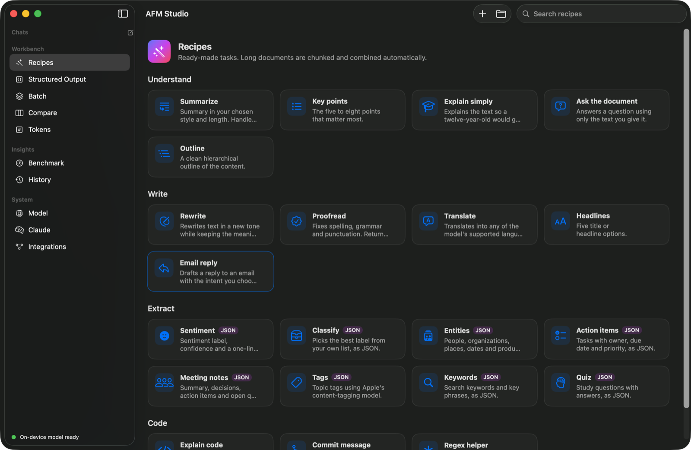
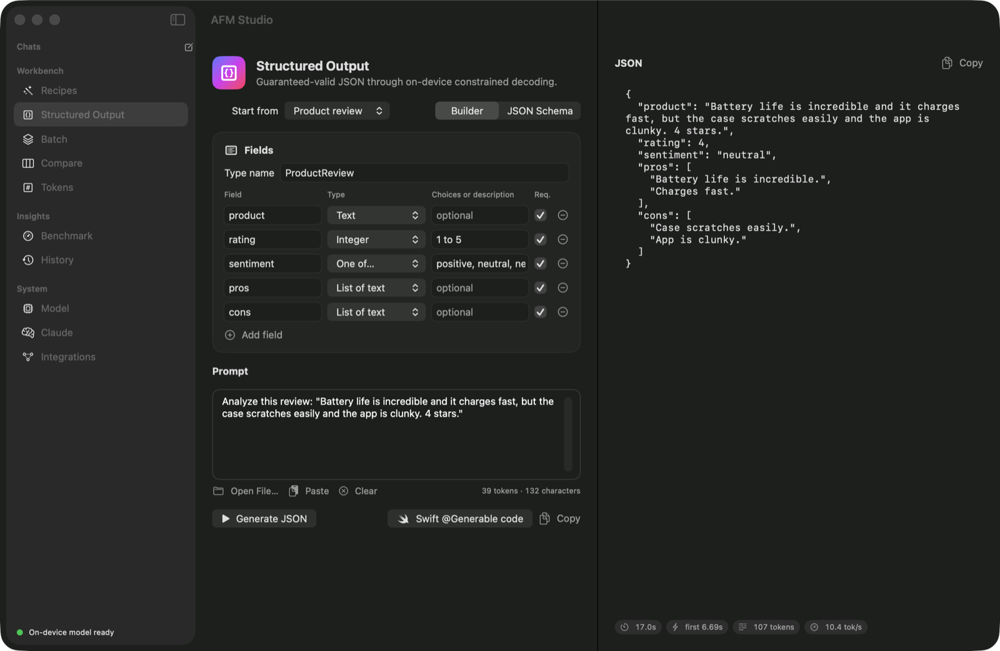
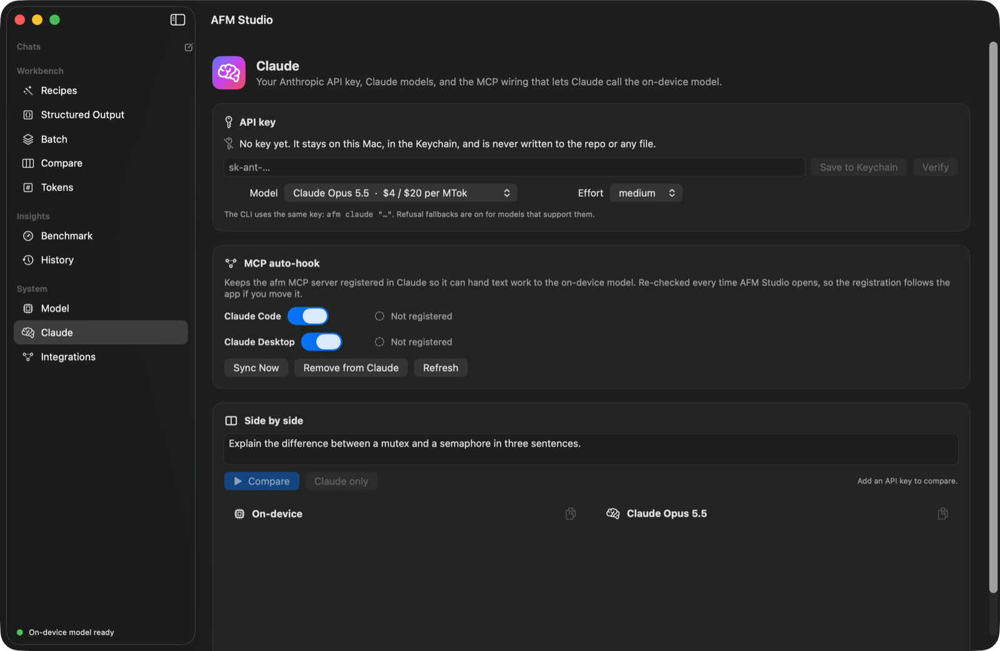

# AFM Studio

**Apple's on-device foundation model, everywhere you work on a Mac.** A native SwiftUI app, a command-line tool (`afm`), an MCP server for Claude, and a local OpenAI-compatible API. All of it is one Swift package. Its one third-party dependency is [SwiftTerm](https://github.com/migueldeicaza/SwiftTerm) (MIT, pinned to an exact version), which powers the built-in terminal.



The model is the roughly 3-billion-parameter model behind Apple Intelligence. It runs on the Mac itself. It's free and works offline, and what you send the model stays on your Mac. A few features use the network on purpose, and each one is off until you turn it on. [Security and privacy](#security-and-privacy) lists them.

## What's inside

| Surface | What it gives you |
| --- | --- |
| **AFM Studio app** | Chat with tools, 21 recipes, a structured-output builder, batch runs over folders, side-by-side comparisons, a token inspector, benchmarks, history, an integrated terminal, and a menu-bar quick-ask panel. |
| **`afm` CLI** | Pipe-friendly prompts, recipes, JSON extraction, resumable chats, token counts and benchmarks. |
| **MCP server** (`afm mcp`) | 15 tools that let Claude hand text work to the on-device model, plus tools from any integration you turn on. Files are processed locally with `path`, so their contents never enter Claude's context. |
| **OpenAI-compatible API** (`afm serve`) | `/v1/chat/completions` on `127.0.0.1`, with streaming and `response_format: json_schema`. |
| **Claude section** | Your Anthropic API key in the macOS Keychain, on-device vs. Claude comparisons with cost, and automatic MCP registration in Claude Code and Claude Desktop. |
| **Integrations** | Optional connections to outside services, each off until you turn it on. GitHub is the first. |

## Requirements

- A Mac with Apple silicon, running macOS 27.1 or later
- Apple Intelligence turned on in System Settings
- The Xcode Command Line Tools with the macOS 27 SDK. The full Xcode app is optional.

Run `afm status` to check whether the model is ready.

## Install

```bash
git clone https://github.com/ry-ops/afm-studio.git ~/Projects/afm-studio
bash ~/Projects/afm-studio/scripts/build-app.sh --install
```

That builds the app and installs it as `/Applications/AFM Studio.app`, then links the `afm` command into `~/.local/bin`. The scripts work from any folder. If you cloned somewhere else, use that path instead.

```bash
bash ~/Projects/afm-studio/scripts/build-app.sh   # build only, into ~/Projects/afm-studio/build
bash ~/Projects/afm-studio/scripts/install.sh     # CLI only: links afm into ~/.local/bin
```

If you can't write to `/Applications`, `--install` uses `~/Applications` instead. An older copy in `~/Applications` goes to the Trash, and a running copy is quit first.

The first build downloads SwiftTerm through Swift Package Manager. After that, builds work offline. The app is ad-hoc signed for local use. On first launch it links `~/.local/bin/afm` to its bundled CLI and registers the MCP server with Claude. You can turn that off in the Claude section.

## macOS 27 and AFM 3

In 2026 Apple announced its third generation of foundation models, AFM 3, alongside macOS 27. AFM Studio requires macOS 27.1 or later and builds with the macOS 27 SDK. Here is what changed.

- **Custom adapters are gone.** The macOS 27 SDK removes the API for loading `.fmadapter` files, and it has no replacement. AFM Studio dropped the `--adapter` flag, the adapter line in `afm status` and the Model pane's adapter card. Settings saved by an older version still load, and any adapter path in them is ignored.
- **Apple ships its own `fm` command.** macOS 27 adds a command-line tool named `fm`. AFM Studio's command stays `afm`, so the two don't collide.
- **Views use `@ViewState`, not `@State`.** The macOS 27 SDK turns `@State` into a macro whose plugin ships with Xcode but not with the Command Line Tools. `@ViewState` is an alias for the same property wrapper, so the app builds with either toolchain. Use it in new views.
- **Errors use the new framework types.** macOS 27 reports model failures as `LanguageModelError` instead of `GenerationError`. AFM Studio maps the new types, so its messages and fix hints are back, and chats again summarize older turns when the context fills up.
- **Not yet supported.** The macOS 27 framework adds image input, the Private Cloud Compute model, Dynamic Profiles and an Evaluations framework. They aren't in AFM Studio yet. The [roadmap](ROADMAP.md) covers them.

## The app



- **Chat:** streaming replies with tool calls shown inline. The model warms up as soon as you start typing, so the first token arrives sooner. Date and time and an exact calculator are on by default. System info, reading files in your home folder, listing folders and fetching a web page are opt-in. Chats are saved, and they appear in the sidebar whether you started them in the app, in Terminal or from Claude. When the 4,096-token context fills up, older turns are summarized automatically.
- **Recipes:** summarize, key points, ask-the-document, rewrite, proofread, translate, sentiment, classify, entities, action items, meeting notes, tags, quiz, commit messages and more. Inputs longer than the context are split on paragraph and sentence boundaries, run piece by piece, and combined. You can write your own recipes in the app or as JSON files.
- **Structured output:** build a schema with fields or paste JSON Schema, then watch valid JSON stream in. Apple's constrained decoding guarantees the result matches the schema. One click exports the schema as Swift `@Generable` code.
- **Batch:** drop files or folders, pick a recipe, then export the results as JSON Lines, CSV or Markdown.
- **Compare:** run one prompt with several sampling settings at once.
- **Tokens:** exact counts from the on-device tokenizer, measured against the context window.
- **Benchmark:** time to first token and tokens per second on your Mac, charted.
- **History:** every run from every surface, stored only on this Mac.
- **Model:** availability, capabilities and supported languages.
- **Integrations:** turn integrations on, see what each touches, and choose whether its tools reach chat and Claude. GitHub has tabs for an inbox, issues and PRs, repos, write-ups from a local checkout, blog drafts, and your account.
- **Terminal:** a VS Code-style panel with tabs under every pane, running your login shell. **Explain** asks the on-device model what the output means. See [The terminal](#the-terminal).
- **Menu bar:** ask a question, or summarize, proofread, rewrite or translate whatever is on the clipboard.

## The terminal

Press **⌃`** (Control-backtick) or click the terminal button in the toolbar. The panel opens under whatever pane you're on, like the terminal in VS Code.

- **Real shells.** Each tab runs your login shell (`$SHELL`) in a real pseudo-terminal, so colors, `vim`, `top`, `ssh` and your prompt work as they do in Terminal.app. `afm` is on the `PATH`.
- **Tabs.** ⌃⇧` opens a new tab, and **Terminal > New Terminal in Folder…** starts one in a folder you pick. Shells keep running while the panel is hidden. A tab closes when its shell exits.
- **Layout.** Drag the line above the panel to resize it, or maximize it to fill the window. The panel's height and text size are remembered.
- **Explain** (⇧⌘E). Sends the selected text, or the latest output if nothing is selected, to the on-device model. A side panel shows what happened and, for an error, the likely cause and fix. Type a follow-up question about the same output, or copy the answer. Long output is trimmed to the newest part that fits the context. Explain never runs commands. It can be wrong, so read a command before you run it.

| Shortcut | Action |
| --- | --- |
| ⌃` | Show or hide the terminal |
| ⌃⇧` | New terminal tab |
| ⇧⌘E | Explain the selection or the latest output |
| ⌃L | Clear the screen (your shell handles it) |

The shell starts with a clean environment, the way Terminal.app starts one, and your shell's startup files set the rest. It sets `TERM=xterm-256color`, `COLORTERM=truecolor` and `TERM_PROGRAM=AFMStudio`. It passes through `SSH_AUTH_SOCK`, `TMPDIR`, `AFM_HOME` and `AFM_ALLOWED_PATHS`, so `ssh`, `git` and `afm` behave as they do elsewhere.

The terminal is the one part of AFM Studio built on a third-party package: [SwiftTerm](https://github.com/migueldeicaza/SwiftTerm) 1.99.0 (MIT), pinned to that exact version in `Package.swift`.

## The CLI

```bash
afm "Explain DNS like I'm new to networking"
git diff | afm run commit-message
afm run summarize -f report.md -p style="an executive summary"
pbpaste | afm run translate -p language=Japanese
afm extract --fields "vendor:string, total:number, items:[string]" < receipt.txt
afm --tool safe "What's 17.5% of 2,340, and what day is it?"
afm chat --session ideas          # resumable; /help inside for commands
afm tokens -f big-file.txt
afm bench
afm recipes                       # lists recipes and their -p parameters
```

Streaming is on by default in a terminal. Add `--json` for machine-readable output and `--stats` for timing and token counts. `afm --help` lists everything.

## Claude integration



### MCP server

AFM Studio registers `afm` with Claude Code at user scope and with Claude Desktop. It re-checks the registration every time it opens. Before changing the Claude Desktop config it writes a backup next to the file, and it leaves your other settings alone. To manage the registration yourself:

```bash
afm claude hook      # register in Claude Code and Claude Desktop
afm claude status    # key, model and registration status
afm claude unhook    # remove both registrations
```

| Tool | What it does |
| --- | --- |
| `afm_summarize`, `afm_ask_document` | Summarize text or a file, or answer a question from it. Long inputs are chunked. |
| `afm_extract`, `afm_structured` | JSON that matches `fields` shorthand or a JSON Schema. |
| `afm_classify`, `afm_tag` | Pick a label from your list, or tag topics with Apple's content-tagging model. |
| `afm_rewrite`, `afm_proofread`, `afm_translate` | Text transformations. |
| `afm_generate`, `afm_chat` | Free-form prompts and saved multi-turn chats. |
| `afm_recipes`, `afm_run_recipe` | Run any recipe, including your own. |
| `afm_count_tokens`, `afm_status` | Tokenizer and model status. |

Most tools accept `path` instead of `text`. With `path`, Claude can have a 50-page file summarized without reading it into its own context. File access is limited to your home folder. Set `AFM_ALLOWED_PATHS` (colon-separated) to allow other folders. Key and credential files are always refused, wherever they are. [Security and privacy](#security-and-privacy) lists them.

`afm_chat` keeps its own conversations. Claude can continue only chats it started, never ones from the app or Terminal. Its chats never get the file or web tools.

### Your Anthropic API key

The key is stored in your macOS login Keychain, which your login password protects. It is never written to the repo, the settings file or any other file. The Keychain trusts the program that saved the key. Other programs, and AFM Studio after a rebuild, have to ask you before they can read it. You can add the key in the app's Claude section, or from Terminal:

```bash
afm claude key set           # paste the key when prompted (input is hidden), or pipe it in
afm claude key status        # shows where the key comes from, masked
afm claude key rm            # removes it from the Keychain
afm claude "Review this plan" --model claude-opus-5-5 --effort high
afm claude compare "Explain mutexes vs semaphores"   # on-device vs Claude, with cost
```

`ANTHROPIC_API_KEY` works as a fallback. Claude Opus 5.5 is the default model. Requests opt into server-side refusal fallbacks on the models that support them.

## Integrations

Integrations connect AFM Studio to outside services. Each one is its own module, and each starts **off**. Turning one on shows you what it signs in with, which hosts it talks to, and whether it can ever write. Then there are three switches:

- **On:** the master switch. While it's off, no credentials are read and none of its tools exist.
- **Tools in chat:** the on-device model may call its read-only tools. Each chat still opts in, because every tool costs context.
- **Tools for Claude:** its tools appear in the afm MCP server. Restart Claude after changing this.

```bash
afm integrations                              # list them, with what each one touches
afm integrations enable github --claude off   # on, but keep its tools away from Claude
afm integrations disable github
```

### GitHub

Read-only, drafts only. The on-device model does the reading and writing; AFM Studio never posts, labels or commits. Drafts come with links that open GitHub pre-filled so you can review and submit them yourself.

| Feature | CLI | Tool for Claude |
| --- | --- | --- |
| Digest of what needs you: reviews, assignments, mentions, your PRs | `afm github digest --days 2` | `afm_github_digest` |
| Summary of an issue or PR, including the diff | `afm github summarize owner/repo#12` | `afm_github_summarize` |
| Triage: type, priority, labels from the repo's own set, missing info, possible duplicates | `afm github triage owner/repo#12` | `afm_github_triage` |
| PR description for your current branch, or for an existing PR | `afm github pr ~/code/app` | `afm_github_pr_description` |
| Release notes since the last tag, grouped by commit type | `afm github release ~/code/app` | `afm_github_release_notes` |
| Project brief: state, activity, open work, next steps | `afm github brief owner/repo` | `afm_github_repo_brief` |
| Up to five next-step issue drafts | `afm github next owner/repo` | `afm_github_next_steps` |
| Blog post drafts in your blog repo's format | `afm github blog draft "topic" --from-repo owner/repo` | `afm_github_blog_draft` |

**Sign-in.** A GitHub token in the Keychain wins (`afm github auth set`, or the app's GitHub > Account tab). Otherwise AFM Studio borrows your `gh` login, then `GITHUB_TOKEN` or `GH_TOKEN`. A fine-grained, read-only token is the tightest option. `afm github auth rm` removes the Keychain token.

**Blog drafts.** `afm github blog setup owner/blog-repo` reads the repo once and learns where posts live, the frontmatter author, the allowed categories, and any "Writing Style" section in its docs. That setup stays on this Mac. Drafts are saved as Markdown with matching frontmatter. The on-device writer plans an outline and then writes each part, because a whole post won't fit in its context. It can still get facts wrong, so give it good notes and read the result. With an Anthropic key you can pick Claude as the writer instead.

**Honest limits.** Summaries and triage are solid. PR descriptions summarize each changed file first so large diffs still fit. Long-form writing is where a 3-billion-parameter model shows its size.

## OpenAI-compatible API

```bash
afm serve --port 11535            # or toggle it in the app's CLI & API pane
```

```python
from openai import OpenAI
client = OpenAI(base_url="http://127.0.0.1:11535/v1", api_key="unused")
r = client.chat.completions.create(model="apple-foundation-model",
                                   messages=[{"role": "user", "content": "Hello!"}])
```

The server offers three models. `apple-foundation-model` uses the default guardrails. `apple-foundation-model-permissive` uses looser guardrails for transforming your own text. `apple-foundation-model-tagging` uses Apple's content-tagging model.

It supports `stream`, `temperature`, `top_p`, `seed`, `max_tokens`, and `response_format` with `json_schema` or `json_object`. With `json_object`, any Markdown code fence the model puts around the JSON is removed, so the reply parses as is. It also serves `GET /afm/recipes` and `POST /afm/recipes/{id}`.

The server listens only on `127.0.0.1`. Web pages from other sites can't use it:

- **Host check.** It answers only requests addressed to `127.0.0.1` or `localhost`. That stops DNS rebinding, where a website points its own name at your Mac.
- **Origin check.** It refuses requests from web pages served by any other site, and it sends no CORS headers.
- **JSON only.** `POST` bodies must be sent as `Content-Type: application/json`. Browsers can't send that cross-site without asking first, and the server refuses to answer. With `curl`, add `-H 'Content-Type: application/json'`.
- **Request timeout.** A client has 30 seconds to send its whole request, so stalled connections can't use up the 32 connection slots. Long responses and streams aren't cut off.

Any program running as you on this Mac can still call the server. Add `--token <secret>` to require `Authorization: Bearer <secret>`. Clients then pass the secret as their API key.

```bash
afm serve --port 11535 --token "$(openssl rand -hex 16)"
```

## Know the model

- **Good at:** summaries, extraction, classification, tagging, rewriting, short drafts, and translation in 15 languages (23 locales).
- **Not good at:** world knowledge, multi-step math, long reasoning and writing code. Treat its output as a draft. The calculator tool exists because the model alone gets arithmetic wrong.
- **Context:** 4,096 tokens for instructions, prompt and reply combined. AFM Studio works around this with chunking and chat compaction.
- **Guardrails:** Apple's safety filter sometimes blocks harmless prompts. The permissive mode, `--permissive`, helps when you're transforming text you supplied.

## Security and privacy

**What leaves your Mac.** Prompts to the on-device model never do. These features use the network, and each one starts off:

| Feature | Talks to | Turned on by |
| --- | --- | --- |
| Fetch web page tool | the URL the model picks | each chat, or `--tool fetch_url` |
| GitHub integration | `api.github.com` | Integrations, then the GitHub switch |
| Claude features | `api.anthropic.com` | adding an Anthropic API key |
| Blog drafts written by Claude | `api.anthropic.com` | choosing Claude as the writer |

**Files the model and Claude can't read.** The file tools and the MCP `path` argument read only from your home folder and any `AFM_ALLOWED_PATHS` folders. Inside those, these are always refused:

- **Folders:** `~/.ssh`, `~/.gnupg`, `~/.aws`, `~/.azure`, `~/.kube`, `~/.docker`, `~/.config/gh`, `~/.config/gcloud`, `~/.config/op`, `~/.config/hub`, `~/.config/github-copilot`, `~/.claude`, `~/.password-store`, `~/.terraform.d`, `~/Library/Keychains`, `~/Library/Cookies`, `~/Library/Mail`, `~/Library/Messages`, `~/Library/Safari`, the Chrome, Firefox, Brave and Edge profiles, Claude Desktop's settings, and AFM Studio's own data folder. Letter case doesn't matter: `~/.SSH` is refused too.
- **Files anywhere:** `.env` and `.env.*`, `.netrc`, `.npmrc`, `.pypirc`, `.git-credentials`, `.pgpass`, `.my.cnf`, `.claude.json`, `.vault-token`, `.terraformrc`, `credentials`, `credentials.json` and `credentials.toml` files, and SSH private keys.
- **Extensions:** `.pem`, `.key`, `.p12`, `.pfx`, `.keychain`, `.keychain-db`, `.kdbx` and `.ovpn`.

**Web fetches stay on the public internet.** `fetch_url` refuses local and private addresses, and it checks every redirect too. That covers `localhost`, your home network, `.local` names and cloud metadata addresses. It also checks the address each connection actually reached, so a DNS server that answers with a public address and then a private one (DNS rebinding) gets nothing back. A page the model reads can't send it to your router or to local services. Set `AFM_FETCH_ALLOW_PRIVATE=1` if you want it to reach your own network.

**Tool combinations.** A chat with both a file tool and Fetch web page on gets a warning. A file or web page with hidden instructions could make the model read a file and send it to a website in a URL. Turn on both only when you trust everything the model will read.

**Local git repos.** The GitHub integration only reads local checkouts. Branch, tag and commit names that look like git options, such as `--output=<file>`, are refused. Git also won't run the external diff, textconv or fsmonitor commands that a repo's own config can set.

**Local data.** Chats, history, recipes and settings are stored unencrypted in `~/Library/Application Support/AFMStudio`. History keeps the first 4,000 characters of each input. Turn history off in Settings, or set `AFM_NO_HISTORY=1`.

**Reporting a problem.** See [SECURITY.md](SECURITY.md).

## Environment variables

| Variable | What it does |
| --- | --- |
| `AFM_HOME` | Stores chats, recipes, history and settings in another folder. |
| `AFM_ALLOWED_PATHS` | Extra folders the file tools and MCP `path` may read, separated by colons. |
| `AFM_FETCH_ALLOW_PRIVATE` | Set to `1` to let `fetch_url` reach local and private addresses. |
| `AFM_NO_HISTORY` | Set to `1` to skip writing history. |
| `AFM_DEBUG` | Set to `1` to print full underlying errors to stderr. |
| `AFM_INSTALL_DIR` | Where `scripts/install.sh` links `afm`. The default is `~/.local/bin`. |
| `ANTHROPIC_API_KEY` | Fallback Anthropic key when the Keychain has none. |
| `GITHUB_TOKEN`, `GH_TOKEN` | Fallback GitHub tokens after the Keychain and `gh`. |
| `NO_COLOR` | Turns off colored terminal output. |

## Troubleshooting

- **Apple Intelligence is off.** Turn it on in System Settings > Apple Intelligence & Siri. Then run `afm status`.
- **The model is still preparing.** It downloads after Apple Intelligence is first turned on. Wait a few minutes and try again.
- **A harmless prompt is blocked.** Apple's guardrails sometimes misfire. Try `--permissive` when you're transforming your own text.
- **The input is larger than the context window.** The model has 4,096 tokens in total. Use a recipe, which chunks long input, or check the size with `afm tokens`.
- **A Keychain prompt after rebuilding.** Each ad-hoc build is a new program to the Keychain. Choose Always Allow, or save the key again.
- **Claude doesn't list the afm tools.** Run `afm claude status`, then restart Claude Code or Claude Desktop.
- **The API server answers with 403 or 415.** Use `127.0.0.1` or `localhost` in the URL, and send `Content-Type: application/json`.
- **A command works in Terminal.app but not in the app's terminal.** Both start your login shell, but GUI apps don't inherit what you export in one Terminal window. Put `PATH` changes in `~/.zprofile` or `~/.zshrc`.
- **Explain is grayed out.** It needs the on-device model. Check the status dot at the bottom of the sidebar, or run `afm status`.
- **`fetch_url` says an address is private.** That's the network guard. Set `AFM_FETCH_ALLOW_PRIVATE=1` if you meant to reach your own network.

## Uninstall

```bash
afm claude unhook                     # remove the MCP registration from Claude Code and Claude Desktop
afm claude key rm                     # delete the Anthropic key from the Keychain
afm github auth rm                    # delete the GitHub token from the Keychain
rm -rf /Applications/"AFM Studio.app" ~/Applications/"AFM Studio.app" ~/.local/bin/afm ~/.local/share/afm-studio
rm -rf ~/Library/Application\ Support/AFMStudio            # chats, history, recipes and settings
rm -f ~/Library/Application\ Support/Claude/claude_desktop_config.afm-backup.json
defaults delete dev.ry-ops.afm-studio                      # terminal height and text size
```

## Project layout

```
Sources/AFMKit       engine: generation, schemas, tools, recipes, chunking, chats, Claude client, Keychain, hooks, integration registry
Sources/AFMServer    MCP stdio server and OpenAI-compatible HTTP server
Sources/AFMGitHub    the GitHub integration (its own module)
Sources/afm          the CLI
Sources/AFMStudio    the SwiftUI app, including the terminal panel (TerminalView.swift)
Tests/SelfTest       self-test (swift run afm-selftest)
scripts/             app bundle, icon and install scripts
```

```bash
swift build
swift run afm-selftest            # unit checks, plus a live model check when Apple Intelligence is available
swift run afm-selftest --offline  # skip the live check
```

The self-test is a plain executable because Swift Testing doesn't run under the Command Line Tools alone. It needs no Xcode.

Data such as chats, recipes, history and settings lives in `~/Library/Application Support/AFMStudio`. Set `AFM_HOME` to use a different folder.

## License

AFM Studio is released under the [MIT License](LICENSE).
